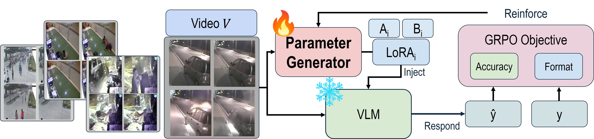

<div align="center">

# COPRA

### Conditional Parameter Adaptation with Reinforcement Learning for Video Anomaly Detection

**Advances in Neural Information Processing Systems (NeurIPS 2026)**

[Darryl Cherian Jacob](https://dzj0055.github.io) · Xinyu Liu · Kai Wang · [Pan He](https://panhe.org/)

Auburn University · Tencent Hunyuan

[**Paper**](https://arxiv.org/abs/2605.15325) · [**NeurIPS**](https://neurips.cc/virtual/2026/poster/151176) · [**Model Checkpoints**](https://drive.google.com/drive/folders/1vPP3sV08ZhV2uXLy02xo19pUiHROLToH?usp=sharing) · [**Code**](https://github.com/THE-MALT-LAB/COPRA)

</div>

---

## Overview

**COPRA** is a framework for **instance-conditioned parameter adaptation** of vision–language models (VLMs) for video anomaly detection. Instead of learning one fixed adapter for all videos, COPRA generates **input-specific LoRA parameters** that adapt a frozen VLM to the visual content of each video segment.

This approach addresses two limitations of existing VLM-based anomaly detection methods:

1. **The shared-parameter bottleneck.** A single static adaptation must accommodate diverse scenes, events, and anomaly categories, which can limit generalization under distribution shift.
2. **Training–inference mismatch.** Models are often trained using sparsely sampled frames from long videos but evaluated on dense, short video segments.

COPRA learns to generate the adaptation weights on the fly, aligning parameter generation with the content being evaluated. The generator is optimized using **Group Relative Policy Optimization (GRPO)** with video-level supervision. Beyond anomaly detection, we study transfer to video question answering and dense video captioning.

## Method

<p align="center">
  
</p>

<p align="center"><sub>Overview of the COPRA framework. The illustration is reproduced from our paper.</sub></p>

Given a video, COPRA:

1. **Encodes visual context** using the pretrained visual encoder.
2. **Generates conditional low-rank updates** with a lightweight parameter generator, producing LoRA matrices tailored to the input.
3. **Adapts the frozen VLM** by injecting the generated updates during inference, without updating the backbone's pretrained weights.
4. **Optimizes parameter generation with reinforcement learning** using GRPO and video-level reward signals.

The same mechanism supports video-level and finer-grained temporal adaptation. Full architectural details, training objectives, and ablations are provided in the [paper](https://arxiv.org/abs/2605.15325).

## Results

COPRA improves upon frozen-backbone baselines on both **UCF-Crime** and **XD-Violence** using the same model backbones and evaluation pipeline.

| Benchmark | Backbone | Frozen VLM | COPRA | Improvement |
|:--|:--|--:|--:|--:|
| UCF-Crime (AUC ↑) | Qwen2-VL-7B-Instruct | 81.31 | **86.75** | +5.44 |
| UCF-Crime (AUC ↑) | InternVL2-8B | 84.31 | **87.14** | +2.83 |
| XD-Violence (AP ↑) | Qwen2-VL-7B-Instruct | 64.36 | **73.96** | +9.60 |
| XD-Violence (AP ↑) | InternVL2-8B | 74.32 | **76.52** | +2.20 |

<sub>All values are percentages. Results correspond to the final stage of the evaluation pipeline reported in the paper; improvements are absolute percentage-point gains. See the paper for cross-dataset generalization, ablations, and additional video understanding evaluations.</sub>

## Codebase

We provide two COPRA implementations, corresponding to different VLM backbones. Each implementation has its **own environment, scripts, and detailed documentation**.

| Directory | Backbone | Instructions |
|:--|:--|:--|
| [`HYWUChat-R1.5/`](./HYWUChat-R1.5/) | Qwen2-VL / VideoChat-R1.5-based pipeline | [README](./HYWUChat-R1.5/README.md) |
| [`HYWUVLM-R1/`](./HYWUVLM-R1/) | InternVL-based pipeline (InternVL2 / InternVL3) | [README](./HYWUVLM-R1/README.md) |

**Start with the README for your chosen backbone.** The implementation-specific instructions are the source of truth for dependencies, checkpoint configuration, training, and evaluation.

## Getting Started

### 1. Clone the repository

```bash
git clone https://github.com/THE-MALT-LAB/COPRA.git
cd COPRA
```

### 2. Select a backbone and install its dependencies

Choose either [`HYWUVLM-R1/`](./HYWUVLM-R1/README.md) or [`HYWUChat-R1.5/`](./HYWUChat-R1.5/README.md), then follow its environment setup instructions. **Use separate environments** for the two implementations where their dependency versions differ.

### 3. Download checkpoints and datasets

The released COPRA checkpoints are available on [Google Drive](https://drive.google.com/drive/folders/1vPP3sV08ZhV2uXLy02xo19pUiHROLToH?usp=sharing). Download the checkpoint corresponding to your selected backbone and configure its path as described in the relevant implementation README.

The anomaly detection evaluation uses [UCF-Crime](https://www.crcv.ucf.edu/projects/real-world/) and [XD-Violence](https://roc-ng.github.io/XD-Violence/). Obtain these datasets from their original sources and configure dataset paths for your environment. **Datasets are not included** in this repository.

### 4. Run evaluation

From your selected implementation directory, use the provided evaluation scripts:

```bash
# Example: InternVL implementation
cd HYWUVLM-R1

sh eval_vid_level.sh       # UCF-Crime
sh eval_vid_level_xd.sh    # XD-Violence
```

The corresponding evaluation scripts are also documented under [`HYWUChat-R1.5/`](./HYWUChat-R1.5/README.md). Check the scripts and implementation-specific README for required model, dataset, and output paths before execution.

## Citation

If you use COPRA in your work, please cite our **NeurIPS 2026** paper:

```bibtex
@inproceedings{jacob2026copra,
  title     = {COPRA: Conditional Parameter Adaptation with Reinforcement Learning for Video Anomaly Detection},
  author    = {Jacob, Darryl Cherian and Liu, Xinyu and Wang, Kai and He, Pan},
  booktitle = {Advances in Neural Information Processing Systems},
  year      = {2026},
  url       = {https://arxiv.org/abs/2605.15325}
}
```

## Acknowledgments

This repository builds on the pretrained VLM ecosystems used by the respective implementations. Please also follow their licenses and cite the underlying model and dataset papers when appropriate.

For questions about the research, please refer to the paper or open a GitHub issue.
